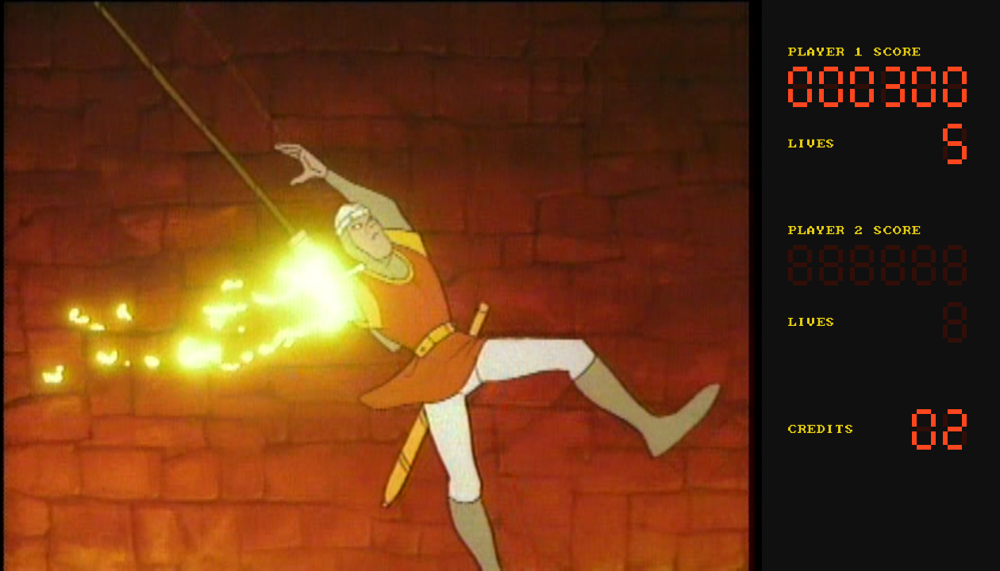
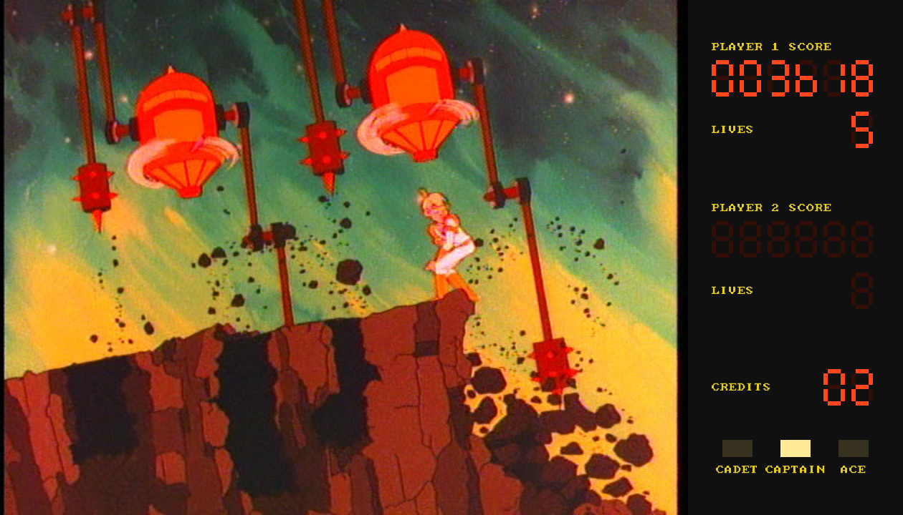
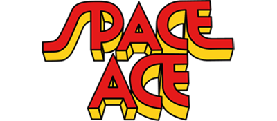
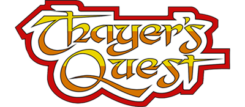
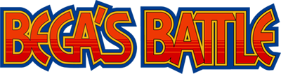
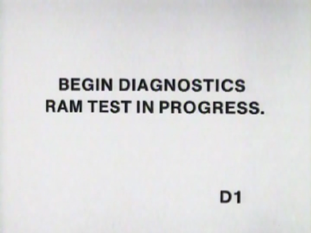
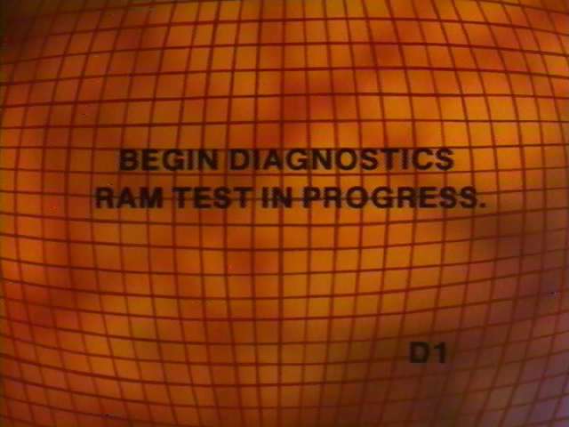

# Playing LaserVault

How to run the games, the keys, the options, and what each game needs.
(To build the program first, see [DEVELOPING.md](DEVELOPING.md).)

- [Running](#running): what you need, the command, the keys and controllers
- [Options](#options) and [what to expect](#what-to-expect)
- The games: [Dragon's Lair](#dragons-lair) and its
  [DIP switches](#dip-switches), [Space Ace](#space-ace),
  [Super Don Quix-ote](#super-don-quix-ote), [Esh's Aurunmilla](#eshs-aurunmilla),
  [Cliff Hanger](#cliff-hanger), [Badlands](#badlands), [Astron Belt](#astron-belt),
  [Galaxy Ranger](#galaxy-ranger), [Cobra Command](#cobra-command),
  [Thayer's Quest](#thayers-quest), [Bega's Battle](#begas-battle),
  [Dragon's Lair II](#dragons-lair-ii), [Us vs. Them](#us-vs-them),
  [Road Blaster](#road-blaster), [M.A.C.H. 3](#mach-3), [Goal to Go](#goal-to-go),
  [GP World](#gp-world)
- [Screenshots](#screenshots)
- [Driving the laserdisc player yourself](#driving-the-laserdisc-player-yourself)

## Running

You need your own copy of the game:

- **The video:** Daphne-style `.m2v` clips with their `.ogg` soundtracks,
  plus a framefile (for Dragon's Lair, `dragonslair.txt`) that maps disc
  frame numbers to clips. If the video came as an archive, extract it with
  [7-Zip](https://www.7-zip.org/) or `unrar`; for split archives, point the
  tool at the first part. There's no need to run a self-extracting `.exe`.
- **The ROMs:** Dragon's Lair rev F2, as `lair.zip` or a folder holding
  `dl_f2_u1.bin` to `dl_f2_u4.bin`. Some other sets work too; see
  [Dragon's Lair](#dragons-lair). For the other games, see
  [Space Ace](#space-ace), [Super Don Quix-ote](#super-don-quix-ote),
  [Esh's Aurunmilla](#eshs-aurunmilla), [Cliff Hanger](#cliff-hanger),
  [Badlands](#badlands), [Astron Belt](#astron-belt),
  [Galaxy Ranger](#galaxy-ranger), [Cobra Command](#cobra-command),
  [Thayer's Quest](#thayers-quest), [Bega's Battle](#begas-battle),
  [Dragon's Lair II](#dragons-lair-ii), [Us vs. Them](#us-vs-them),
  [Road Blaster](#road-blaster), [M.A.C.H. 3](#mach-3),
  [Goal to Go](#goal-to-go) and [GP World](#gp-world).

Daphne and Singe sets usually come as one folder per game, laid out like
this:

```
lair.daphne/
    lair.txt            the framefile
    *.m2v, *.ogg        the video clips and their soundtracks
    roms/lair.zip       the ROMs
    sounds/             recorded sound effects (Astron Belt, Galaxy Ranger)
```

Folders laid out like this for every game here are preserved on the
Internet Archive, in [these uploads](https://archive.org/details/@jeff_nyman/uploads);
each game's section below links its own.

Then give laser-vault the folder, and it finds the rest:

```
laser-vault path/to/lair.daphne --fast-boot
```

It works out which `.txt` file is the framefile (one that lists clips,
preferring one named like the folder) and which zip in `roms` holds a game
it knows, and the console says what it chose. Without a `roms` folder, it
plays the disc without the game. If your files are laid out differently,
name them yourself; the options also override what the folder lookup finds:

```
laser-vault path/to/dragonslair.txt --video-dir path/to/mpeg/dragonslair --roms path/to/lair.zip --fast-boot
```

The game sections below show this long form; the folder form works for
every game.

Press 5 to insert a coin, then 1 to start (or add `--free-play`, in the
games that have it, and skip the coins). When the game starts, the console
says how many coins make a credit (Dragon's Lair, as it comes set, takes
two) and what the game's buttons do; each game's section below says more.

| Key                   | Action                                    |
|-----------------------|-------------------------------------------|
| Arrow keys            | joystick (Road Blaster, GP World: steering; GP World: up and down shift gear) |
| Space / Ctrl          | the action button: Dragon's Lair's sword, the fire button, Cliff Hanger's and Goal to Go's hands; Road Blaster, GP World: the accelerator |
| Shift                 | the second button: Cliff Hanger and Goal to Go: feet; Cobra Command, M.A.C.H. 3: missiles; Road Blaster, GP World: the brake; Esh's Aurunmilla, Bega's Battle, Us vs. Them: button 2 (in games with one button, the action button) |
| Z                     | Bega's Battle, Us vs. Them: button 3      |
| 5 / 6                 | insert a coin (slot 1 / 2)                |
| 1 / 2                 | start (1 / 2 players)                     |
| F1 / F2 / F3          | Space Ace: skill level Cadet / Captain / Ace |
| P / Pause             | pause / resume (Thayer's Quest: Pause only, since P is a letter) |
| A                     | Dragon's Lair, Space Ace, Esh's Aurunmilla, Cliff Hanger, Goal to Go, Badlands, Cobra Command (Data East's), Road Blaster, Dragon's Lair II: autoplay on / off (see below) |
| S                     | show / hide the score displays (Dragon's Lair, Space Ace) |
| D                     | turn combing repair off / on (not in Thayer's Quest) |
| Tab                   | show / hide subtitles (Thayer's Quest)    |
| F11 / Alt+Enter       | fullscreen on / off                       |
| F12                   | save a screenshot (see [Screenshots](#screenshots)) |
| Escape                | quit                                      |

The number keys work on the top row or the numeric keypad. The console
prints a line for each coin, start, button and skill-level press, and each
move of the stick. Its first line is the version, such as
`laser-vault 0.1.0 (041cf10)`; put that in any report of a problem, so it's
clear which build it was.

Game controllers work too, plugged in before or during play:

| Controller            | Action                                    |
|-----------------------|-------------------------------------------|
| D-pad or left stick   | joystick                                  |
| any face button       | sword (the action button); in games with two or more buttons, bottom and left are button 1, right and top button 2 |
| Back (Select)         | insert a coin                             |
| Start                 | start (1 player)                          |
| left / right shoulder, right trigger | Space Ace: Cadet / Captain / Ace; the left shoulder is also button 3 (Bega's Battle, Us vs. Them) |

That covers Xbox, PlayStation and Switch pads, and arcade sticks that
present themselves as one; the console names each controller as it
connects. Arcade-stick encoders that act as a keyboard (such as the I-PAC)
work out of the box, since the keys above follow MAME's defaults. If SDL
doesn't recognize your stick as a controller, you can describe it to SDL
with the `SDL_GAMECONTROLLERCONFIG` environment variable (see SDL's
[gamecontrollerdb](https://github.com/mdqinc/SDL_GameControllerDB)).

## Options

| Option                | Meaning                                                        |
|-----------------------|----------------------------------------------------------------|
| `--video-dir DIR`     | where the video clips are (default: next to the framefile)     |
| `--roms ROMS`         | run the game, from its ROM set (`lair.zip`, `ace.zip`, `superdq.zip`, `esh.zip`, `cliff.zip`, `badlands.zip`, `astronp.zip`, `galaxy.zip`, `cobraab.zip`, `tq.zip`, `bega.zip`, `lair2.zip`, ...) or a folder of ROM files |
| `--fast-boot`         | run the start-up (the disc spinning up, the board's checks) at full speed, and open the window in the attract mode |
| `--scores`            | Dragon's Lair, Space Ace: show the score displays beside the picture (also the S key) |
| `--attract-sound`     | sound in the attract mode (Dragon's Lair: in every cycle, not just every few), in the games with a switch for it |
| `--unlimited-lives`   | the hero never loses a life, so you can see the whole game (the games with a switch for it) |
| `--free-play`         | no coins needed: press 1 to start (the games with a switch for it) |
| `--autoplay`          | Dragon's Lair, Space Ace, Esh's Aurunmilla (sets 1 and 3), Cliff Hanger (set 1), Goal to Go, Badlands, Cobra Command (Data East's), Road Blaster, Dragon's Lair II (3.19): the program plays the game for you (also the A key) |
| `--samples DIR`       | Astron Belt, Galaxy Ranger: the folder of their recorded sound effects (default: a `sounds` or `sound` folder beside the ROMs' folder) |
| `--no-subtitles`      | Thayer's Quest: start with the narrator's subtitles hidden (Tab shows them) |
| `--dsw1 HEX`, `--dsw2 HEX` | set the game's DIP switches directly (see [DIP switches](#dip-switches); Cliff Hanger and Goal to Go also have `--dsw3`, `--dsw4`) |
| `--record FILE.mp4`   | make a video of the game instead of showing it (see [Recording a video](#recording-a-video)) |
| `--seconds N`, `--until-frame N[+S]` | with `--record`: stop after N seconds of video, or as the disc plays up to frame N (or S seconds after) |
| `--press BUTTON@T[:LEN]` | with `--record`: press a button T seconds into the video, for LEN seconds (default 0.2) |
| `--fullscreen`        | start fullscreen (F11 or Alt+Enter switches back)              |
| `--icon FILE.ico`     | use a different window icon                                    |
| `--version`           | print the version and the commit it was built from, and stop   |
| `--frame N`           | without `--roms`: the frame to start on                        |
| `--disc-fps F`        | rate the disc's frame numbers count at (default: the game's own, 23.976 for Dragon's Lair and Space Ace, 29.97 for the others; 23.976 without `--roms`; see `src/video/disc_video.h`) |

## What to expect

This is what playing Dragon's Lair is like, and most of it holds for the
other games; each game's section below says where it differs.

**Start-up.** Like the real machine, the game waits about 20 seconds for
the laserdisc to spin up, and the attract mode starts after about 35.
`--fast-boot` runs that start-up at full speed before the window appears, so
you land straight in the attract mode.

**Scores.** On the arcade cabinet the scores, lives and credits aren't on
the screen but on LED displays in the bezel around it. `--scores` (or S)
shows them in a panel beside the picture. The window title always shows the
raw display digits and what the laserdisc player is doing.

<p align="center">
  <a href="assets/dl-scores-1.png"></a>
  <a href="assets/sa-scores-1.png"></a>
</p>

**Between scenes** the screen goes black for a moment while the laserdisc
player searches, as on the real machine. Longer jumps take a little longer,
from about 0.1 s up to 0.3 s.

**Sound.** The soundtrack comes from the `.ogg` file next to each video clip,
played in step with the picture. The beeps (the credit chord, and a short
tone for each joystick move or sword press) come from the board's
AY-3-8910 sound chip, emulated and mixed in. With the factory settings the
attract mode is mostly silent: a DIP switch ("Sound Every 8 Attracts") has
the game turn the disc's sound off and let it through only every few cycles,
about every five minutes. `--attract-sound` flips that switch.

**Unlimited lives.** `--unlimited-lives` turns on the game's own "Unlimited
Dirks" DIP switch, meant for operators: Dirk still dies when you get a move
wrong, but never loses a life.

**Autoplay.** Dragon's Lair, Space Ace, Esh's Aurunmilla, Cliff Hanger,
Goal to Go, Badlands, Data East's Cobra Command, Road Blaster and Dragon's
Lair II have it; it works from what each game keeps in memory about the moves it's
waiting for, and hasn't been written for the other games. With
`--autoplay`, or after pressing A, the program plays the controls itself;
you still insert coins and press start. It plays the whole game, from the
first room to rescuing Daphne, without losing a life, with the original
ROMs and both DLE sets; Space Ace too, original and SAE, at every skill
level, to Borf's defeat. Press A at any time to take over, and again to
hand back. The console prints each move it makes. (For the other seven,
see their sections.)

It works by reading the game's mind. While a scene plays, the game keeps a
list in RAM of the inputs it's watching for, each with its time windows and
what happens if you press it in each one. Nothing in the list says which
outcome is good, so the program tries each move on a copy of the whole
machine, runs the copy a few seconds ahead (hundreds of times faster than
real time), and makes the move after which the hero doesn't lose a life,
and can survive the move after that. `src/games/cinematronics/autoplay.c`
describes the list.

The planning runs on its own thread, a few moves ahead of the game: the
copy carries on from each planned move, so every move is decided long
before it's due, and the picture never waits. Each move records what the
game should look like at the moment it's made; if the game has strayed
from the plan (you pressed something too, say), the plans are thrown away
and planning starts again from where the game is.

**Window icon.** Each game has its own icon (versions of the same game,
such as Galaxy Ranger and Star Blazer, share one), built into the program
from `icons/`. `--icon FILE.ico` uses another.

<h2 id="dragons-lair"></h2>

The game's folder, ready to play, is preserved on the Internet Archive:
[archive.org/details/dragons.lair.laser.disc](https://archive.org/details/dragons.lair.laser.disc).

The usual set is a folder laid out the way laser-vault looks for (see
[Running](#running)), with the two fan-made sets beside the original:

```
lair.daphne/
    lair.txt, dl-slates.m2v, dls00.vob.m2v, ... (and their .ogg files)
    roms/lair.zip, roms/dle11.zip, roms/dle20.zip, roms/dle21.zip
```

```
laser-vault path/to/lair.daphne --fast-boot
```

That plays `lair.zip`, the one named like the folder. For another set, add
`--roms path/to/lair.daphne/roms/dle11.zip` (or `dle20.zip`, `dle21.zip`).
All the sets play the same disc, so they share the framefile.

Give `--roms` a different set and the program works out which one it is,
says so on the console, and sets the DIP switches the way that set expects.

- **`lair.zip`, rev F2:** the arcade original, Cinematronics' last US
  revision. It's what laser-vault was built and tested against. Like the
  arcade machine, it leaves some of the disc unused: for instance, a game
  starts with the castle and then cuts to Dirk running past the portcullis,
  skipping the drawbridge.
- **`dle11.zip`, Dragon's Lair Enhancement 1.1** (Dave Hallock, 2000): the
  same game, built from rev F, with the cuts undone. Every scene and death
  scene on the disc (with a few small exceptions) is now used, scenes play
  to their end, there are some new choices, and errors in the original game
  data are fixed. The set whose files end in `l` is the one tuned for the
  LD-V1000.
- **`dle20.zip`, Dragon's Lair Enhancement 2.0** (Dave Hallock and Jeff
  Kulczycki, 2002): a bigger rework, meant to play the way the animators
  designed the game. It starts at the drawbridge, groups the scenes into
  sections (castle, caverns, the lair), brings back a scene you died on at
  the end of its section, and scores differently. Its prototype mode needs
  the scenes on a Limited Edition disc pressed in 2002, so laser-vault sets
  it to the standard game.
- **`dle21.zip`, Dragon's Lair Enhancement 2.1** (2005): 2.0 fitted onto
  three chips instead of four, with a fix to one of the prototype scenes;
  the same switches. It plays, but hasn't been played through as much as
  the others.
- **Revs D, E and F:** earlier US revisions for the LD-V1000. They should
  work, but haven't been tested.

Each DLE zip includes its authors' readme, which describes every change and
what the DIP switches do in that set. The program tells you if a chip
doesn't match the known copy, and explains why it can't run the sets it
doesn't support: the early revisions made for the Pioneer PR-7820 player,
and the European board.

## DIP switches

The game board has two banks of eight DIP switches, DSW1 and DSW2, that
the operator sets inside the cabinet: pricing, lives, difficulty and so on.
Each ROM set starts with its usual settings (rev F2: DSW1 `20`, DSW2 `79`;
DLE 1.1: `20`, `F9`; DLE 2.0 and 2.1: `20`, `E9`; Space Ace rev A3: `DD`,
`FE`; SAE: `20`, `89`; the other games' sections give theirs), and the
console shows the settings in use when the game starts.

`--dsw1 HEX` and `--dsw2 HEX` replace a whole bank. `--free-play`,
`--attract-sound` and `--unlimited-lives` then change their own switches on
top, so you can combine them. In rev F2, the bits mean (from MAME's
`dlair.cpp`):

| Bit    | DSW1                                   | DSW2                                          |
|--------|----------------------------------------|-----------------------------------------------|
| `01`   | coins per credit: clear 2, set 3       | sound every 8 attracts (`--attract-sound` clears it) |
| `02`   | unused                                 | demo sounds: set turns them off               |
| `04`   | difficulty mode                        | unlimited Dirks (`--unlimited-lives`)         |
| `08`   | engineering mode                       | laserdisc player: set = LD-V1000 (leave it set) |
| `10`   | two credits always (`--free-play`)     | difficulty (with `80`)                        |
| `20`   | lives: clear 3, set 5                  | pay-as-you-go options (with `40`)             |
| `40`   | pay as you go                          | pay-as-you-go options (with `20`)             |
| `80`   | diagnostics                            | difficulty (with `10`)                        |

So `--dsw1 00` gives 3 lives. The fan sets (DLE and SAE) change what several
switches do; their readmes have the charts. They number the switches 0 to 7
and give physical positions, where OFF means the bit is set. The original
Space Ace and Super Don Quix-ote have layouts of their own (see
[Space Ace](#space-ace) and [Super Don Quix-ote](#super-don-quix-ote)). In
every set, the three named options flip whichever switches that set uses,
if it has them. Every other game's section lists its own switches: Cliff
Hanger and Goal to Go have four banks, Us vs. Them and M.A.C.H. 3 one, and
the rest two. Esh's Aurunmilla and Dragon's Lair II keep their settings in
memory instead, so they have no DIP switches at all.

<h2 id="space-ace"></h2>

The game's folder, ready to play, is preserved on the Internet Archive:
[archive.org/details/space.ace.laser.disc](https://archive.org/details/space.ace.laser.disc).

Space Ace (1983) came from the same team and runs on the same Cinematronics
board, so laser-vault plays it the same way. You need:

- **The video:** Daphne-style clips and their framefile (`sae.txt` in the
  usual set; both ROM sets play the same disc).
- **The ROMs:** either of these.
  - **`ace.zip`, rev A3:** the arcade original, chips `sa_a3_u1.bin` to
    `sa_a3_u5.bin`. (Revs A and A2 aren't supported; A3 replaced them.)
  - **`sae.zip`, Space Ace Enhancement 1.0:** a fan set by Dave Hallock
    (2002), chips `sae10_u1.bin` to `sae10_u5.bin`. It uses all the
    animation on the disc, smooths the transitions and fixes problems in
    the original program; its readme describes the changes.

The usual set is a folder laid out the way laser-vault looks for (see
[Running](#running)):

```
sae.daphne/
    sae.txt, sa-slates.m2v, spa00.vob.m2v, ... (and their .ogg files)
    roms/ace.zip, roms/sae.zip
```

```
laser-vault path/to/sae.daphne --fast-boot
```

With the folder named `sae`, that plays `sae.zip`, the Enhancement. For the
arcade original, add `--roms path/to/sae.daphne/roms/ace.zip`.

Insert two coins and press 1, then choose a skill level within a few seconds
with F1, F2 or F3 (on a controller: left shoulder, right shoulder, right
trigger). Cadet plays about half the animation, Captain more, and Ace all
of it. On the cabinet these were three buttons on the control panel.

The original's DIP switches are its own, and mostly work the opposite way
to MAME's labels for them (a bit set is the switch off), which is probably
why MAME lists Space Ace as not working. laser-vault starts it with DSW1
`DD` and DSW2 `FE`: every switch off except the LD-V1000 player, which is
how the game expects to be set up. `src/games/cinematronics/board.c` lists
what each switch does; `--free-play`, `--unlimited-lives` and
`--attract-sound` flip the right ones.

SAE uses Dragon's Lair's DIP switches, apart from skill (B:6 and B:7; with
both on, as laser-vault sets them, you pick with the buttons) and a "hard"
mode on B:8 that its authors advise against.

On the cabinet, a lamp beside each skill button flashes while the game
waits for you to choose, and the chosen one stays lit. The score panel
shows them under the credits. The game drives the lamps through the score
display's wires, with a code a separate lamp board picked off before it
reached the digits; `src/games/cinematronics/board.c` describes it. Space
Ace also uses a letter code for a blank digit, so the panel shows only
digits; the window title shows the raw codes.

<h2 id="super-don-quix-ote"></h2>

The game's folder, ready to play, is preserved on the Internet Archive:
[archive.org/details/sdq.laser.disc](https://archive.org/details/sdq.laser.disc).

Super Don Quix-ote (Universal, 1984) runs on Universal's own board, the
System 1. Like the Cinematronics board, it has a Z80 that drives an LD-V1000
player, but it can also draw over the picture: the scores, lives and
credits, the messages, and the arrows that tell you which way to move. You
need:

- **The video:** the Daphne-style clip `sdq.m2v` with its soundtrack, and
  the framefile (`sdq.txt` in the usual set).
- **The ROMs:** `superdq.zip` (or `sdq.zip`), the "long scenes" version:
  `sdq-prog.bin` (the program), `sdq-char.bin` (the letters and arrows drawn
  over the picture) and `sdq-cprm.bin` (their colours). The two "short
  scenes" sets (`sdq_c45.rom` or `sdq_c45a.rom`, with their own letters,
  `sdq_a8.rom`) should work too, but haven't been tested; a zip holding only
  the program chip takes the colours from the long set's zip beside it, but
  needs `sdq_a8.rom` too.

The usual set is a folder laid out the way laser-vault looks for (see
[Running](#running)):

```
sdq.daphne/
    sdq.txt, sdq.m2v, sdq.ogg (and the test clips sdq-blank, sdq-colorbars, sdq-crosshairs)
    roms/sdq.zip
```

```
laser-vault path/to/sdq.daphne --fast-boot
```

Press 5 to insert a coin (one coin per credit at the factory setting), then
1 to start. When an arrow appears over the picture, push the joystick that
way before it goes; each one you miss costs a life. Everything the game
shows is drawn on the screen by the board itself, so there's no score panel.

The game keeps time with the disc: every few fields it asks the player
which frame it's on, and times the arrows from the answer. The overlay's
place on the picture is worked out from how the game sets up its video
chip (a real cabinet to compare with would settle it).

Its DIP switches, from MAME's `superdq.cpp` (the game's own code agrees): a
switch on reads as a clear bit, and the factory setting is every switch off.

| Bit    | DSW1                                        | DSW2                    |
|--------|---------------------------------------------|-------------------------|
| `03`   | difficulty: both set easy, both clear hardest | coin slot 2: both set 1 coin 1 credit |
| `04`   | clear: no sound in the attract mode         | coin slot 1 (with `08`) |
| `08`   | clear: no bonus life (set: at 100,000)      | coin slot 1 (with `04`): both set 1 coin 1 credit |
| `30`   | lives: both set 3, `20` only 4, `10` only 5, neither 2 | unused       |
| `40`   | clear: unlimited lives (`--unlimited-lives`) | unused                 |
| `80`   | clear: free play (`--free-play`)            | unused                  |

With demo sounds off, the game plays the attract mode's video in a way the
player keeps silent; `src/ldp/ldv1000.c` explains.

<h2 id="eshs-aurunmilla"></h2>

The game's folder, ready to play, is preserved on the Internet Archive:
[archive.org/details/esh.laser.disc](https://archive.org/details/esh.laser.disc).

Esh's Aurunmilla (Funai/Gakken, 1984) runs on Funai's own board: another Z80
driving an LD-V1000, with tiles drawn over the picture for the score and
the menus. You need:

- **The video:** the Daphne-style clip `esh.m2v` with its soundtrack, and
  the framefile (`esh.txt` in the usual set).
- **The ROMs:** `esh.zip`, MAME's set 1, under MAME's chip names (`is1.h8`,
  `is2.f8`, `a.m3`, `b.l3`, `c.k3`, `rgb.j1`, ...) or Daphne's (`h8_is1.bin`,
  `f8_is2.bin`, `m3_a.bin`, ...). Sets 2 and 3, with other program chips,
  should work too, but haven't been tested.

The usual set is a folder laid out the way laser-vault looks for (see
[Running](#running)):

```
esh.daphne/
    esh.txt, esh.m2v, esh.ogg
    roms/esh.zip
    ram/esh.gz       Daphne's saved copy of the board's memory
```

```
laser-vault path/to/esh.daphne --fast-boot
```

The `ram` folder is ignored: laser-vault doesn't keep the board's memory
between runs yet, so the game starts with its own defaults.

Press 5 to insert a coin, then 1 to start. Choose a level (LOW, MIDDLE or
HIGH: push the stick left or right, and the chosen one flickers), and press
Space (button 1) to begin. The video itself shows what to do: at each
danger, a lamp on the control panel lights and the animation shows the way
out (a dial that points left or right, for one), and you push the stick
that way before the scene moves on.

**Autoplay** (`--autoplay`, or A during a game) plays the whole game, from
the first scene to the ending, without losing a life, and carries on into
the next round. Each scene has a record in the game's ROM saying which
control is right (the one the lamps light for) and which scene each answer
leads to, and the game counts its way through the window as the scene
plays, so the board presses the right control while the window is open
(`src/games/funai/board.c` explains). You still insert the coin, press
start and choose the level. Set 2's second program chip is different, and
autoplay doesn't know it.

MAME lists the game as not working. laser-vault's own reading of the game
code gives the pieces MAME was missing: the laserdisc link runs in the
interrupt that the player's command strobe raises once a field, and the
colour PROM has see-through pixels (where the disc's picture shows) and a
blue background for the menus, chosen by whether the game has the picture
switched on. The board's settings live in battery-backed memory instead of
on DIP switches, so `--free-play` and the other switch options do nothing.
The beeper's pitch isn't known; laser-vault uses MAME's guess of 2 kHz.

<h2 id="cliff-hanger"></h2>

The game's folder, ready to play, is preserved on the Internet Archive:
[archive.org/details/cliff.hanger.laser.disc](https://archive.org/details/cliff.hanger.laser.disc).

Cliff Hanger (Stern, 1983), made from the Lupin III films *The Castle of
Cagliostro* and *Mystery of Mamo*, runs on Stern's own board, with a
different player: the Pioneer PR-8210, a home player the board drives
through its remote-control socket. The player never answers; the game
knows where the disc is by reading the frame numbers recorded in the
picture itself. A TMS9128 video chip draws the score, lives, hints and
messages over the picture. You need:

- **The video:** a Daphne-style clip of the whole disc with its
  soundtrack, and a framefile that names it.
- **The ROMs:** `cliff.zip`, MAME's set 1 (`cliff_u1.bin` to `cliff_u5.bin`).
  Set 2 (`cliffalt.zip`, `cliff_alt_0.bin` to `cliff_alt_3.bin`) plays too.
  It's a different version: it shows no
  hints or score during play, and a credit always costs at least two coins
  (its code has no 1 coin 1 credit setting), so press 5 twice. MAME says
  set 3 fails a start-up check; it hasn't been tried.

The usual set is a folder laid out the way laser-vault looks for (see
[Running](#running)):

```
cliff.daphne/
    cliff.txt                  the framefile, for the 24p clip
    cliff24p_letterbox.txt     a framefile for the letterboxed 24p clip
    ch_640x480_24p.m2v, .ogg   the disc at 23.976 frames a second
    ch_640x480_24p_letterbox.m2v, .ogg
    ch_640x480_30i.m2v, .ogg   the disc at 29.97 frames a second, interlaced
    roms/cliff.zip, roms/cliffalt.zip
    ram/cliff.gz               Daphne's saved high scores and settings
```

```
laser-vault path/to/cliff.daphne --fast-boot
```

It picks `cliff.txt` and `cliff.zip`, the ones named like the folder. The
three clips are the same film (it's widescreen on the disc itself, so
all three have black bars), encoded three ways; laser-vault works out
each one's frame rate and finds the same picture in any of them. To play
another, name its framefile: `laser-vault path/to/cliff.daphne/cliff24p_letterbox.txt
--roms path/to/cliff.daphne/roms/cliff.zip`. The 30i clip has no
framefile, but one is two lines: `.`, then `6 ch_640x480_30i.m2v`. The `ram`
folder is ignored: laser-vault doesn't keep the board's memory between
runs yet, so the game starts with its own default scores and settings.

Press 5 to insert a coin, then 1 to start. Watch for danger: the game shows
a hint at the bottom of the picture, "STICK" (push the joystick the way
Cliff should go) or "ACTION" (a button). There are two buttons, Cliff's
hands (Space) and his feet (Shift), and after a mistake the game tells you
which you should have used. The board's two tones beep for a right move
and boop for a wrong one.

The control panel's feet buttons double as the start buttons, which is how
the game reads them (MAME calls them player 1's and 2's second buttons).
The PR-8210's remote codes, and the way the game sends each one three
times, are described in `src/ldp/pr8210.h`.

**Autoplay** (`--autoplay`, or A during a game) plays set 1 from the first
scene to the end, "CONGRATULATIONS PLAYER 1", without losing a life. It
needs no looking ahead: each scene is a script in the game's ROM, and each
move's record says which control is right and the frames its window opens
and closes on, so the board presses that control as the game starts
checking the move (`src/games/stern/board.c` explains). You still insert
the coin, press start and type your initials. Set 2's program is different
and autoplay doesn't know it.

Its DIP switches, from MAME's `cliffhgr.cpp` (set 1; a switch on reads as a
clear bit):

| Bit    | DSW1                          | DSW2               | DSW3                         | DSW4            |
|--------|-------------------------------|--------------------|------------------------------|-----------------|
| `01`, `02` | lives: both set 3, then 4, 5, 6 | coin slot 1      | service index, switch test   | move difficulty |
| `04`   | clear: no hanging scene       | unknown            | clear: free play (`--free-play`) | (with `01`-`08`) |
| `08`   | clear: regular-length scenes  | unknown            | clear: immortal (`--unlimited-lives`) | (with `01`-`04`) |
| `10`   | clear: score and lives shown during the animation | coin slot 2 (with `20`) | clear: disc test | unknown |
| `20`   | clear: hints for the stick and buttons | (with `10`) | set: demo sounds (`--attract-sound` sets it) | unknown |
| `40`   | hints after mistakes (with `80`: both set never, `80` only after the first, `40` only after the second, neither after the third) | unknown | set: short scenes | unknown |
| `80`   | (with `40`)                   | unknown            | clear: continues allowed     | unknown         |

laser-vault starts set 1 with DSW1 `C7`, DSW2 `FF`, DSW3 `3F` and DSW4
`FF`, MAME's defaults.

<h2 id="badlands"></h2>

The game's folder, ready to play, is preserved on the Internet Archive:
[archive.org/details/badlands.laser.disc](https://archive.org/details/badlands.laser.disc).

Badlands (Konami/Centuri, 1984) runs on Konami's own board: a Motorola 6809
driving an LD-V1000, with tiles drawn over the picture for the score and
the hero's name, and an SN76496 sound chip for the gunshots. You need:

- **The video:** the Daphne-style clip `badlands-pc.m2v` with its
  soundtrack, and the framefile `badlands.txt`.
- **The ROMs:** `badlands.zip`, MAME's set 1 (`badlands.a13`,
  `badlands.a14`, `badlands.c8`, `badlands.c4`). MAME's set 2 has its
  devices at other addresses and isn't supported.

The usual set is a folder laid out the way laser-vault looks for (see
[Running](#running)):

```
badlands.daphne/
    badlands.txt, badlands-pc.m2v, badlands-pc.ogg
    roms/badlands.zip
```

```
laser-vault path/to/badlands.daphne
```

The start-up checks take a few seconds; then the attract mode plays. Press 5
to insert a coin, then 1 to start: the game begins with the story (the
title, then Buck's family and the wanted posters, about half a minute; it
looks much like the attract mode). Press 2 instead to skip the story and go
straight to the first gunfight.

There's one button, the fire button (Space), and the timing is everything.
Each outlaw squares up, then draws. The moment to fire opens as his hand
goes for the gun and closes just after his shot, about half a second (16
frames) in all. His muzzle flash comes a third of the way in, so if you
wait to see it you'll be too late: fire as he draws. Fire while he's still
squaring up and it's too early, and Buck falls. After each shot the gun
takes about half a second to reload, so an early shot also leaves you
unable to fire when it counts. (For the first gunman, the window is disc
frames 3236 to 3251, as the game's own scene table has it.)

**Autoplay** (`--autoplay`, or A during a game) makes every shot, and holds
fire where a shot would cost a life: it plays through to the end, Buck
riding into the sunset under "YOU WIN, CONGRATULATIONS!", and on through
the rounds that follow (in tests, twenty minutes) without losing a life. The game runs from a script in its
ROM, and each shot's command gives the frames its window opens and closes
on, where the game goes with and without the shot, and, for the chances
to shoot early, the points each way scores, which shows whether to shoot
(`src/games/konami/board.c` explains). You still insert the coin and press
start.

MAME lists the game as not working. Reading the game's code gave the
missing pieces: the interrupts (the NMI at vertical blank sends the
player's next command, and the player's strobe starts the game's work for
the field), the DIP switch banks (MAME has them the other way round), and
how the sound chip is wired (its data lines are reversed, so the game
reverses each byte's bits before sending it). Badlands' player also ran
Konami's own version of the player's software: a digit leaves it ready
for the next byte, so the game sends a frame number one digit a field, and
it has a command to skip back 16 frames. The sound effects run from a timer
interrupt whose rate isn't known for sure; laser-vault uses eight a field,
which gives notes of sensible lengths.

Its DIP switches (a switch on reads as a clear bit):

| Bank | Bits | Meaning |
|------|------|---------|
| DSW1 | all  | coinage: `FF` 1 coin 1 credit, `EE` 1 coin 2 credits, `88` 2 coins 1 credit, `00` free play (`--free-play`); MAME's `konblands.cpp` lists the rest |
| DSW2 | `01`, `02` | lives: both set 2, `02` alone 3, `01` alone 5, neither 7 |
| DSW2 | `80` | set: no sound in the attract mode (`--attract-sound` clears it) |

The other switches in DSW2 are unused (the manual says to leave them off,
that is, set). laser-vault starts with DSW1 `FF` and DSW2 `7E`: 1 coin 1
credit, 3 lives, sound in the attract mode. Hold both start buttons as the
game powers on for its service mode.

<h2 id="astron-belt"></h2>

The game's folder, ready to play, is preserved on the Internet Archive:
[archive.org/details/astron.belt.laser.disc](https://archive.org/details/astron.belt.laser.disc).

Astron Belt (Sega, 1983; Bally Midway in America) runs on Sega's own board:
a Z80 driving a laserdisc player, with sprites (your fighter, the enemy ships and
their shots) and characters (the score, the timer, the messages) drawn over
film of space battles. You need:

- **The video:** the Daphne-style clip (`astron512.m2v` in the usual set)
  with its soundtrack, and the framefile (`astron.txt`).
- **The ROMs:** either version. `astron.zip` (MAME's `astron`, program
  chips `5473c` and `5474a`) is the version for Sega's own laserdisc player,
  which the board drives over a serial line. `astronp.zip` (MAME's
  `astronp`) is the version for Pioneer's LD-V1000, and holds just its two
  program chips (`abp-ic03.bin`, `abp-ic10.bin`), with the rest in
  `astron.zip` beside it; laser-vault looks there too, as MAME does, and
  then in any other zip in the same folder. A folder holding all the chips
  works as well. The two play the same.
- **The sound effects** (optional): see **Sound** below.

The usual set is a folder laid out the way laser-vault looks for (see
[Running](#running)):

```
astron.daphne/
    astron.txt, astron512.m2v, astron512.ogg
    roms/astron.zip, roms/astronp.zip
    sounds/ab_*.wav
```

```
laser-vault path/to/astron.daphne
```

With both zips there, it picks `astron.zip`, the one named like the
folder. For the LD-V1000 version, add `--roms path/to/astron.daphne/roms/astronp.zip`.

Press 5 to insert a coin, then 1 to start. The arrow keys fly the fighter
(up is up the screen) and Space fires. The game starts on a timer (60
seconds, an operator setting) with unlimited ships: you can be hit, but
you don't run out. When the timer runs out you get a few reserve ships
(more for scoring well), and losing those ends the game. The film itself
has explosions and battles in it, which play whatever you do.

**Sound.** The soundtrack comes from the disc. The board's own sound
effects (your shots, the enemies', the ship, the alarm tones on a coin and
at the start) came from a separate sound board, which isn't emulated:
instead, laser-vault plays recordings of its sounds, the ones made for the
Daphne emulator (`ab_ship.wav`, `ab_fire.wav`, `ab_enemy.wav` and
`ab_alarm1.wav` to `ab_alarm4.wav`), when the game asks the sound board for
each one. It looks for them in a `sounds` folder beside the ROMs' folder
(`astron.daphne/roms/` and `astron.daphne/sounds/`, as in the usual set;
`sound`, Daphne's own name for the folder, works too), or in the folder
`--samples` names, and says at start-up what it found. Without them the
game plays with the soundtrack alone.

The soundtrack file was made with an early Vorbis encoder that FFmpeg's own
decoder can't read, so laser-vault uses the reference decoder, libvorbis,
for Vorbis (the Windows build gets it through vcpkg; Linux distributions'
FFmpeg packages include it).

The game keeps track of the disc by asking the player for the frame number
now and then, and jumps between stretches of film as the battle goes; the
player answers with each digit as its character code, which is what the
game expects.

MAME lists the game as not working (it stops in what it calls a
"pseudo-attract mode") and doesn't draw the sprites. The sprite format and
the colours come from the Daphne emulator; the stick follows Sega's
schematic (Daphne has up and down the other way round, which flies the
ship like an aircraft).

Its DIP switches (from MAME's `segald.cpp`; not yet checked against the
game):

| Bank | Bits | Meaning |
|------|------|---------|
| DSW1 | `F0` | coin slot 1: `F0` 1 coin 1 credit; MAME lists the rest |
| DSW1 | `0F` | coin slot 2, the same way |
| DSW2 | `80` | set: demo sounds (`--attract-sound` sets it) |
| DSW2 | `60` | play timer: both set 60 s, `20` 50 s, `40` 40 s, neither unlimited |
| DSW2 | `10` | set: normal difficulty, clear: hard |
| DSW2 | `0C` | reserve ships at: both set 5000, 10000, 20000 (MAME lists the rest) |
| DSW2 | `02` | set: continues allowed |

laser-vault starts with DSW1 `FF` and DSW2 `FF`. There's no free play
setting, so `--free-play` does nothing.

<h2 id="galaxy-ranger"></h2>

The game's folder, ready to play, is preserved on the Internet Archive:
[archive.org/details/galaxy.ranger.laser.disc](https://archive.org/details/galaxy.ranger.laser.disc).

Galaxy Ranger (Sega, 1984; Bally Midway in America; Star Blazer in Japan)
is Astron Belt's sequel on the same board: through tunnels, over alien
deserts and cities, and into dogfights, to the enemy's battle cruiser. It
plays the same way (see [Astron Belt](#astron-belt)). You need:

- **The video:** a Daphne-style clip of the disc with its soundtrack
  (`galaxyr.m2v` in the usual set), and the framefile that names it
  (`galaxy.txt`). An older encoding, `galaxy.m2v` (1.5 GB, interlaced, its
  framefile starting `41 galaxy.m2v`), plays the same.
- **The ROMs:** Galaxy Ranger's `galaxy.zip` (`gr5633.bin` and
  `gr5634.bin`, MAME's `galaxyr`), the version for Sega's own laserdisc
  player; or Star Blazer's (`epr-5590.bin` and `epr-5591.bin`, MAME's
  `sblazerp`), for Pioneer's LD-V1000, which plays the same disc and whose
  screens say "Starblazer". Galaxy Ranger's own Pioneer version
  (`epr-5613.bin` and `epr-5614.bin`, MAME's `galaxyrp`) should work too,
  but hasn't been tested. The graphics chips are the same in all; a set
  missing some (some copies of `galaxy.zip` lack the colour PROM,
  `5279`) takes them from the parent set, `galaxyr.zip`, or any other zip
  in the same folder.

The usual set is a folder laid out the way laser-vault looks for (see
[Running](#running)):

```
galaxyr.daphne/
    galaxy.txt, galaxyr.m2v, galaxyr.ogg
    roms/galaxy.zip, roms/starblazer.zip
    sounds/gr_*.wav
```

```
laser-vault path/to/galaxyr.daphne
```

Neither zip is named like the folder, so it takes the first one it knows,
`galaxy.zip` (the version for Sega's player, borrowing its colour PROM from
`starblazer.zip`). For Star Blazer, add
`--roms path/to/galaxyr.daphne/roms/starblazer.zip`.

Its sound effects are recordings too, as for Astron Belt: `gr_fire.wav`,
`gr_cannon.wav`, `gr_attack.wav`, `gr_mineon.wav` and `gr_alarm1.wav` to
`gr_alarm4.wav`, in a `sounds` (or `sound`) folder beside the ROMs' folder
or the folder `--samples` names. Without them it plays with the soundtrack
alone. Its DIP
switches are taken to be Astron Belt's, which hasn't been checked.

<h2 id="cobra-command"></h2>

The game's folder, ready to play, is preserved on the Internet Archive:
[archive.org/details/cobra.command.laser.disc](https://archive.org/details/cobra.command.laser.disc).

Cobra Command (Data East, 1984) came in two versions, and laser-vault runs
both: Data East's own, on the board Bega's Battle uses, driving Sony's
LDP-1000, and Sega's, on the board Astron Belt and Galaxy Ranger use,
driving Sega's own laserdisc player. From the cockpit of an attack
helicopter you fight through New York, the desert and the sea; the board
draws the cockpit, the radar, the score and lives, and the gun sight over
the film. You need:

- **The video:** the Daphne-style clip of the disc with its soundtrack
  (`cobra.m2v` in the usual set), and the framefile (`cobra.txt`).
- **The ROMs:** either version. `cobra.zip` is Data East's (MAME's
  `cobra`: program chips `au00-2` to `au03-2`, the sound CPU's `au06`, and
  the graphics chips `au07` to `au09` and `au0a` to `au0c`). `cobraab.zip`
  is Sega's (MAME's `cobraseg`: `ic-1.bin`, `ic-2.bin`, and its own
  graphics and colour chips `ic-7`, `ic-8`, `ic-11`, `ic-12`, `ic-13`).

The usual set is a folder laid out the way laser-vault looks for (see
[Running](#running)):

```
cobra.daphne/
    cobra.txt, cobra.m2v, cobra.ogg
    roms/cobra.zip
```

```
laser-vault path/to/cobra.daphne
```

For Sega's version, add `--roms path/to/cobraab.zip`.

Press 5 to insert a coin, then 1 to start. The arrow keys move the gun
sight, Space fires the guns and Shift the missiles.

**Data East's version** waits about 21 s for the disc to spin up
(`--fast-boot` skips that); its attract mode is the film alone, with nothing
drawn over it. Its sound effects come from the board's two sound chips, as in
Bega's Battle. The canopy's two struts are drawn the way the game's tiles
fit together, which isn't how the board is thought to lay them out (see
`src/games/dataeast/board.c`); tell us if you know how the real screen
looks. Its DIP switches, as the game's code reads them (MAME lists
them as unknown; a switch on reads as a clear bit):

| Bank | Bits | Meaning |
|------|------|---------|
| DSW1 | `03` | coin slot 1: `03` 1 coin 1 credit, `02` 3 coins 1 credit, `01` 1 coin 2 credits, `00` 2 coins 1 credit |
| DSW1 | `0C` | coin slot 2, the same way |
| DSW2 | `01` | set: 3 lives; clear: 5 |
| DSW2 | `06` | the score for a bonus life |
| DSW2 | `18` | two tables of settings, perhaps the difficulty |
| DSW2 | `20` | set: the disc's sound in the attract mode (`--attract-sound` sets it) |
| DSW2 | `40` | read at start-up; what it does isn't known |
| DSW2 | `80` | set: the game; clear: the board's test program |

laser-vault starts it with DSW1 `0F` and DSW2 `FF`. There's no free play
setting, so `--free-play` does nothing.

**Autoplay** (`--autoplay`, or A during a game) flies Data East's version
through all ten stages to the ending without losing a life. As each scene
starts the game copies its record into memory: for a fight, the targets'
windows, positions and the hits it wants; for a dodge, the window and the
direction to push. The board moves the sight onto each target and fires
guns and missiles while its window is open, and holds each direction
through its window (`src/games/dataeast/board.c` explains). You still
insert the coin and press start. Sega's version isn't covered.

**Sega's version**: no recordings of its sound effects are known, so it
plays with the disc's soundtrack alone. Its DIP switches are taken to be
Astron Belt's, which hasn't been checked.

<h2 id="thayers-quest"></h2>

The game's folder, ready to play, is preserved on the Internet Archive:
[archive.org/details/thayer.laser.disc](https://archive.org/details/thayer.laser.disc).

Thayer's Quest (RDI Video Systems, 1984), from Rick Dyer, who designed
Dragon's Lair, runs on RDI's own board: a Z80 driving an LD-V1000, with a
COP421 microcontroller reading the keyboard and an SSI-263 speech chip for
the narrator. A row of LED digits on the cabinet shows the time and score;
laser-vault shows them in the window's title. You need:

- **The video:** the Daphne-style clip `tq.m2v` with its soundtrack, and
  the framefile (`tq.txt` in the usual set). They must be plain MPEG and Ogg
  files: some copies also carry scrambled ones (`tq.m2v.bf`, `tq.ogg.bf`),
  which laser-vault can't read and doesn't need.
- **The ROMs:** `tq.zip`, MAME's set 1 (`tq_u33.bin`, `tq_u1.bin` and the
  COP421's `tq_cop.bin`). Set 2 (`tqalt.zip`, with `thayers.u1`) should
  work too but hasn't been tested; so should the fans' `tq_swear.zip`,
  whose U33 lets the narrator say the words the original won't. A set
  holding only its changed chip takes the rest from `tq.zip` beside it.

The usual set is a folder laid out the way laser-vault looks for (see
[Running](#running)):

```
tq.daphne/
    tq.txt, tq.m2v, tq.ogg
    roms/tq.zip, roms/tqalt.zip, roms/tq_swear.zip
```

```
laser-vault path/to/tq.daphne
```

That plays `tq.zip`, the one named like the folder. For the others, add
`--roms path/to/tq.daphne/roms/tqalt.zip` (or `tq_swear.zip`).

Wait for the disc to spin up (the narrator says so), press 5 to insert a
coin, then any key; type your name and press Enter, and answer the
narrator's questions with Yes (F1) or No (F10). From then on the film
shows your choices, each with a key to press. The game is played on a
keyboard of named buttons, mapped onto the PC's:

| PC key                     | Thayer's Quest key |
|----------------------------|--------------------|
| A to Z                     | the letters (some double as items: W Amulet, E Black Mace, S Dagger, and so on, as printed on the cabinet's keys) |
| 1, 2, 3, 4                 | 1 (Clear), 2, 3 (Enter), 4 (Space) |
| Backspace, Enter, Space    | Clear, Enter, Space |
| F1 to F10                  | Yes, Items, Drop Item, Give Score, Replay, Combine Action, Save Game, Update, Hint, No |
| 5, 6                       | coins |

The console prints each key as it goes in.

**The narrator.** The SSI-263 speaks phonemes, the sounds that make up
words, which the game sends one at a time. How the chip turns them into
sound isn't documented, so laser-vault has its own synthesizer: a buzz at
the pitch the game asks for, and a hiss for sounds like S and SH, shaped
into each phoneme by three resonators, gliding from sound to sound as the
game's settings say. It isn't the chip's voice, and some words are hard to
follow, so the narrator's words are also shown as subtitles (Tab hides
them; `--no-subtitles` starts with them hidden). The cabinet had no
subtitles. The game keeps each line in memory as text spelled the way it
should sound ("PL/EEZ/"), and the subtitles turn that back into ordinary
spelling from a list of the game's words; a word not on the list shows as
the game spells it.

Its DIP switches (from MAME's `thayers.cpp`; a switch on reads as a clear
bit):

| Bank | Bits | Meaning |
|------|------|---------|
| DSW1 | `07` | time a coin buys: all set 110 s, then 95, 80, 70, 60, 45, 30; all clear free play (`--free-play`) |
| DSW1 | `08` | set: 1 coin 1 credit; clear: 2 coins |
| DSW1 | `10` | set: 3 lives; clear: 5 |
| DSW1 | `20` | set: demo sounds (`--attract-sound` sets it) |
| DSW1 | `40` | set: attract sound every time; clear: one time in eight |
| DSW2 | `01` | clear: service mode |
| DSW2 | `08` | set: LD-V1000 (leave it set) |

laser-vault starts with DSW1 `FF` and DSW2 `0F`.

<h2 id="begas-battle"></h2>

The game's folder, ready to play, is preserved on the Internet Archive:
[archive.org/details/bega.laser.disc](https://archive.org/details/bega.laser.disc).

Bega's Battle (Data East, 1983) runs on Data East's own board: two 6502s,
one running the game and one its sound (two AY-3-8910s), driving Sony's
LDP-1000 player over a serial line. The disc holds scenes from the anime
film *Harmagedon*, and the board draws Bega, his enemies, the shots and the
score over them. You need:

- **The video:** the Daphne-style clip `bega.m2v` with its soundtrack, and
  the framefile (`bega.txt` in the usual set).
- **The ROMs:** `bega.zip`, MAME's `begas` (revision 3: `an00-3` to
  `an05-3`, and `an01`, `an06` to `an09`, `an0a` to `an0c`). Revision 1
  (`begar1.zip`, MAME's `begas1`) works too; it holds only its five changed
  chips and takes the rest from `bega.zip` beside it. The colour PROM
  `af-8.bpr` isn't needed: the game sets its colours itself.

The usual set is a folder laid out the way laser-vault looks for (see
[Running](#running)):

```
bega.daphne/
    bega.txt, bega.m2v, bega.ogg
    roms/bega.zip, roms/begar1.zip
```

```
laser-vault path/to/bega.daphne
```

With both zips there, it picks `bega.zip` (revision 3), the one named like
the folder. For revision 1, add `--roms path/to/bega.daphne/roms/begar1.zip`.

Like the real machine it waits about 16 s for the disc to spin up before
the attract mode starts (`--fast-boot` skips that). Press 5 to insert a
coin, then 1 to start. The arrow keys move Bega and Space fires. Luna, the
first friend you rescue (touch her when the game says so), calls the
others; Joe and Sony each bring a power on a button of its own, which the
game names when you rescue them: Shift is the second button and Z the
third (a gamepad's left shoulder works too).

Its DIP switches, as the game's code reads them (MAME and Daphne list them
as unknown; a switch on reads as a clear bit):

| Bank | Bits | Meaning |
|------|------|---------|
| DSW1 | `03` | coin slot 1: `03` 1 coin 1 credit, `02` 3 coins 1 credit, `01` 1 coin 2 credits, `00` 2 coins 1 credit |
| DSW1 | `0C` | coin slot 2, the same way |
| DSW2 | `03` | lives: `03` 3, `02` 5, `01` 4, `00` 6 |
| DSW2 | `04` | clear: you can continue after the game ends |
| DSW2 | `18` | the bonus life (at `00`, also: holding Space fires repeatedly) |
| DSW2 | `20` | difficulty (clear seems the harder) |
| DSW2 | `40` | set: one player only |
| DSW2 | `80` | set: the game; clear: the board's test program |

There's no free play setting, so `--free-play` does nothing; nor a switch
for the attract mode's sound. laser-vault starts with DSW1 `0F` and DSW2
`BB` (3 lives, continues, one or two players).

<h2 id="dragons-lair-ii"></h2>

The game's folder, ready to play, is preserved on the Internet Archive:
[archive.org/details/dragons.lair.2.laser.disc](https://archive.org/details/dragons.lair.2.laser.disc).

Dragon's Lair II: Time Warp (Leland, 1991) runs on Leland's board, which is
built much like an IBM PC XT: an 8088 at 10 MHz, the PC's interrupt
controller, timer and speaker, and Sony's LDP-1450 player on its second
serial port. The board has no graphics of its own: the player draws the
game's words over the picture. You need:

- **The video:** the Daphne-style clips `dl2-00001.m2v` to `dl2-44550.m2v`
  with their `.ogg` soundtracks, and the framefile (`lair2.txt` in the usual
  set). Some copies leave the last clip, `dl2-44550.m2v`, out of the
  framefile; add the line `44550  dl2-44550.m2v` at the end if so. The clips must be plain
  MPEG and Ogg files: some copies come scrambled (as `.m2v.bf` and `.ogg.bf`
  files), and laser-vault can't read those.
- **The ROMs:** `lair2.zip` holding `dl2_319.bin`, the US version 3.19 (MAME's
  `dlair2`). Versions 3.18, 3.15, 3.14 and 3.00 are recognized too, but
  haven't been tried. The 2.xx versions need the disc's first pressing, and
  the European versions drive a Philips player instead: those don't run.

The usual set is a folder laid out the way laser-vault looks for (see
[Running](#running)):

```
lair2.daphne/
    lair2.txt, dl2-00001.m2v ... dl2-44550.m2v (and their .ogg files)
    roms/lair2.zip
    ram/lair2_319.gz     Daphne's saved copy of the game's EEPROM
    sound/               Daphne's recordings for many games (this one needs none)
```

```
laser-vault path/to/lair2.daphne
```

The `ram` folder is ignored for now (see below).

At power on the board checks itself for about 10 s, with a beep part way
(this ROM always fails its own checksum test, and carries on), then sets up
the player and puts the title and copyright on the screen; the attract mode
starts after about 18 s (`--fast-boot` skips all that). Press 5 twice (two
coins make a credit, as the game comes set), then 1 to start. The arrow keys
move Dirk and Space is his sword. On the first level the game names the
moves as they're due ("LEFT").

**Autoplay** (`--autoplay`, or A during a game) plays version 3.19 through
all eight levels to the final score without losing a life. The game keeps
every scene's move and window in a table, and copies the current scene's
window into memory as it starts, so the board presses the move as the
window opens (`src/games/leland/board.c` explains). You still insert the
coins, press start and type your initials. The other versions keep things
at other addresses, and autoplay stays off for them.

The game keeps its settings (coinage, difficulty, free play) and its
bookkeeping in an EEPROM, set from its service mode. laser-vault doesn't
save the EEPROM yet, so each run starts blank and the game sets up its
factory settings; `--free-play` and the other setting options do nothing.

<h2 id="us-vs-them"></h2>

The game's folder, ready to play, is preserved on the Internet Archive:
[archive.org/details/uvt.laser.disc](https://archive.org/details/uvt.laser.disc).

Us vs. Them (Mylstar, 1984; Mylstar was Gottlieb by then) runs on Gottlieb's
arcade board of the time with a laserdisc interface added: an 8088 driving a
Pioneer PR-8210, with tiles and sprites drawn over the picture, and a sound
board of two 6502s with a DAC, two AY-3-8913s and an SP0250 speech chip. You
need:

- **The video:** the Daphne-style clip `uvt-170606.m2v` with its
  soundtrack, and the framefile (`uvt.txt`).
- **The ROMs:** `uvt.zip`, MAME's `usvsthem`: the program chips `usvs.rm0`
  to `usvs.rm4`, the sound CPUs' `usvsdrom.1` and `usvsyrom.1`, the tiles
  `usvs.bg0` and `usvs.bg1`, and the sprites `usvs.fg0` to `usvs.fg3`.

The usual set is a folder laid out the way laser-vault looks for (see
[Running](#running)):

```
uvt.daphne/
    uvt.txt, uvt-170606.m2v, uvt-170606.ogg
    roms/uvt.zip
    ram/uvt.gz       Daphne's saved copy of the board's battery-backed memory
```

```
laser-vault path/to/uvt.daphne
```

At power on the game checks the disc player for itself ("DISC
INITIALIZATION": stop, start, seek), which takes about half a minute
(`--fast-boot` skips most of it), then the attract mode
plays: the title, the scores, the instructions. Press 5 to insert a coin,
then 1 or Space to start: the game starts on the fire button (it never reads
the cabinet's start buttons), and the fire button picks the skill level
too. The arrow keys fly the fighter and Space fires; Shift and Z are the
other two buttons.

The board waits for the player's picture to drop out after each search,
as a real PR-8210's does for a second or more; the player model finds a
frame faster than that, so the board counts the picture as lost for a
second after each search, as Hypseus does (`src/games/gottlieb/board.c`
explains). The speech chip isn't emulated yet, so the game's voice is
silent; the other sound effects play. The board keeps the high scores in
battery-backed memory, which laser-vault doesn't save yet (the `ram` folder
is ignored).

Its DIP switches (from MAME; a switch on reads as a set bit):

| Bits | Meaning |
|------|---------|
| `09` | coinage: `00` 1 coin 1 credit, `08` 2 coins 1 credit, `01` free play (`--free-play`) |
| `04` | set: hard |

laser-vault starts it with `00`.

<h2 id="road-blaster"></h2>

The game's folder, ready to play, is preserved on the Internet Archive:
[archive.org/details/roadblaster.laser.disc](https://archive.org/details/roadblaster.laser.disc).

Road Blaster (Data East, 1985) is a conversion for Bega's Battle's board,
the same two 6502s driving Sony's LDP-1000 (see
[Bega's Battle](#begas-battle)). You need:

- **The video:** the Daphne-style clips `rb0004.m2v` to `rb0042.m2v`,
  `rb0095-96.m2v` and `rbhs.m2v`, each with its soundtrack, and the
  framefile (`roadblaster.txt`). The `.dat` files beside them aren't needed.
- **The ROMs:** `roadblaster.zip`, MAME's `rblaster`: the program chips
  `00.bin` and `01.bin`, the sound CPU's `02.bin`, and the graphics
  `03-06.bin`, `04-07.bin` and `05-08.bin` (each was two chips on the board,
  with the same contents).

The usual set is a folder laid out the way laser-vault looks for (see
[Running](#running)):

```
roadblaster.daphne/
    roadblaster.txt, rb0004.m2v, rb0004.ogg, ... rbhs.m2v, rbhs.ogg
    roms/roadblaster.zip
```

```
laser-vault path/to/roadblaster.daphne
```

Unlike the other Data East games it doesn't wait for the disc: the attract
mode starts at once. Press 5 to insert a coin, then 1 to start. Left and
right steer, Space is the accelerator and Shift the brake; up and down pick
the letters of your initials, and left and right move between them.

The board tells you what to do over the picture, and checks what you're
holding as each moment ends, so hold the control until the prompt goes:

- **A green arrow** beside the sight: steer that way. Steering also moves
  the sight across the screen, and it stays where you leave it.
- **A brake pedal** in the INDICATER box: brake.
- **A turbine** in the box, with red brackets on the screen: steer the sight
  into the brackets and floor the accelerator (without the brake).

Miss one and the car crashes; the disc shows the wreck and the game goes
back to just before it. Its sound effects come from the board's two sound
chips.

Its DIP switches, as the game's code reads them (with Hypseus's notes; a
switch on reads as a clear bit):

| Bank | Bits | Meaning |
|------|------|---------|
| DSW1 | `03` | coin slot 1: `03` 1 coin 1 credit, `02` 3 coins 1 credit, `01` 1 coin 2 credits, `00` 2 coins 1 credit |
| DSW1 | `0C` | coin slot 2, the same way |
| DSW2 | `01` | set: 3 cars; clear: 5 |
| DSW2 | `06` | the score for a bonus car |
| DSW2 | `10` | set: normal; clear: hard |
| DSW2 | `20` | set: the disc's sound in the attract mode (`--attract-sound` sets it) |
| DSW2 | `40` | set: the game starts at the first stage; clear: at a random one |
| DSW2 | `80` | set: the game; clear: it plays itself, ignoring the controls |

laser-vault starts it with DSW1 `0F` and DSW2 `FF`. There's no free play
setting, so `--free-play` does nothing.

**Autoplay** (`--autoplay`, or A during a game) drives the whole game, to
the ending, without a crash. The game marks each prompt in memory while its
window is open, with the way to steer and, for the turbine, the brackets'
range, so the board holds what each prompt wants and keeps the sight in the
brackets (`src/games/dataeast/board.c` explains). You still insert the coin,
press start and type your initials. It was tested at the normal setting and
from the first stage, as the game comes set.

<h2 id="mach-3"></h2>

The game's folder, ready to play, is preserved on the Internet Archive:
[archive.org/details/mach3.laser.disc](https://archive.org/details/mach3.laser.disc).

M.A.C.H. 3 (Mylstar, 1983) runs on the same board as
[Us vs. Them](#us-vs-them): an 8088 driving a Pioneer PR-8210, with tiles
and sprites drawn over the picture, and the sound board of two 6502s. You
need:

- **The video:** the Daphne-style clip `mach3.m2v` with its soundtrack, and
  the framefile (`mach3.txt`, whose clip starts at frame -80).
- **The ROMs:** `mach3.zip`, MAME's set 1: the program chips `m3rom0.bin` to
  `m3rom4.bin`, the sound CPUs' `m3drom1.bin` and `m3yrom1.bin`, the tiles
  `mach3bg0.bin` and `mach3bg1.bin`, and the sprites `mach3fg0.bin` to
  `mach3fg3.bin`.
- **The target data:** `m3target.bin`, in the same zip (Daphne's sets
  include it). The disc carries, on one of its sound tracks, where the
  targets are in the film, a block every 53 frames; the board reads it to
  box the targets and know what you hit. MAME decodes it from the disc's
  sound; laser-vault, like Daphne and Hypseus, reads the decoded blocks
  from this file. Without it the game runs, but shows no targets.

The usual set is a folder laid out the way laser-vault looks for (see
[Running](#running)):

```
mach3.daphne/
    mach3.txt, mach3.m2v, mach3.ogg
    roms/mach3.zip
    ram/mach3.gz     Daphne's saved copy of the board's battery-backed memory
```

```
laser-vault path/to/mach3.daphne
```

At power on the game checks the disc player, then the attract mode plays:
the title, the TOP BRASS scores, and the fighter and bomber games playing
themselves. On the usual DIP switches a game takes two coins: press 5
twice, then 1 or Space (the game starts on the trigger). Push the stick
left for the fighter game or right for the bomber game. The arrow keys fly,
Space is the trigger for the guns, and Shift launches missiles (four at a
time).

The game counts the disc's frames itself, by the board's interrupts, and
checks them against the frame numbers in the target data; if they drift
apart it stops with "DISC ERROR .... STAY PUT!". The speech chip isn't
emulated (as in Us vs. Them); the other sound effects play. The high
scores are kept in battery-backed memory, which laser-vault doesn't save
yet (the `ram` folder is ignored).

Its DIP switches (from MAME; a switch on reads as a set bit):

| Bits | Meaning |
|------|---------|
| `09` | coinage: `09` 4 coins 1 credit, `01` 3 coins, `08` 2 coins, `00` free play (`--free-play`) |
| `02` | set: hard |
| `10` | set: 5 lives; clear: 3 |
| `24` | the bonus lives: `00` at 10,000 and every 10,000; `04` 10,000 and every 20,000; `20` 10,000 and every 40,000; `24` 20,000 and every 60,000 |
| `40` | set: sounds in the attract mode |
| `80` | set: unlimited lives |

laser-vault starts it with `48`: 2 coins 1 credit, 3 lives, the attract
mode's sounds.

<h2 id="goal-to-go"></h2>

The game's folder, ready to play, is preserved on the Internet Archive:
[archive.org/details/gtg.laser.disc](https://archive.org/details/gtg.laser.disc).

Goal to Go (Stern, 1983) is Cliff Hanger's sister game and runs on the
same board (see [Cliff Hanger](#cliff-hanger)): a Z80 driving a Pioneer
PR-8210, with a TMS9128 drawing over the picture. You need:

- **The video:** the Daphne-style clip `gtg.m2v` with its soundtrack, and the
  framefile (`gtg.txt`).
- **The ROMs:** `gtg.zip`, MAME's `goaltogo`: `gtg.rm0` to `gtg.rm4`.

The usual set is a folder laid out the way laser-vault looks for (see
[Running](#running)):

```
gtg.daphne/
    gtg.txt, gtg.m2v, gtg.ogg
    roms/gtg.zip
    ram/gtg.gz       Daphne's saved copy of the board's battery-backed memory
```

```
laser-vault path/to/gtg.daphne
```

The disc has two sides, and the usual video is one of them, side 1. At
power on the game asks the player which side it's playing ("CHECKING FOR
SIDE NO."), by reading a chapter number off the disc: 1 for side 1, 77 for
side 2. laser-vault's player model knows only frame numbers, so the board
answers for the disc: side 1. Everything tried so far plays from side 1;
what the game wants side 2 for, if anything, isn't known yet.

Press 5 to insert a coin and 1 to start. Before each down, the stick picks
a play from the menu and any button starts it (or the clock runs out and
the game picks for you). During the play, as the film itself explains,
the hands button (Space) takes hand-offs and pitches, passes and catches,
the feet button (Shift) kicks, and the stick (the arrow keys) moves the
ball carrier. Hold the stick or press the button when the board prompts
"> STICK <", "> HANDS <" or "> FEET <"; get it wrong and it says what you
should have done ("SHOULD HAVE MOVED DOWN!"), get it right and you gain
yards ("COULD HAVE GONE FURTHER IF YOU HAD MOVED RIGHT!" means you could
have gained more).

**Autoplay** (`--autoplay`, or A during a game) makes every move of a play,
as in Cliff Hanger: the game keeps each play's moves in its ROM, with the
right control and the frames each window opens and closes on. You still
choose the plays (or let the clock choose them). It runs whole drives
without a mistake, touchdowns included; how a game turns out also depends
on the plays chosen.

Its DIP switches (from MAME, and the game's code; a switch on reads as a
clear bit):

| Bank | Bits | Meaning |
|------|------|---------|
| 1 | `80` | clear: say what you should have done after a mistake |
| 1 | `20` | clear: prompt each move ("> STICK <") |
| 1 | `01` | clear: continues allowed |
| 1 | `02` | clear: a continue costs one coin (with `01` clear) |
| 2 | `03` | coin slot 1: `03` 1 coin 1 credit, `02` 2 coins, `01` 3 coins, `00` 4 coins |
| 2 | `30` | coin slot 2, the same way |
| 3 | `80` | clear: show the play's diagram before it |
| 3 | `40` | clear: show the score during the play |
| 3 | `20` | clear: sounds in the attract mode (`--attract-sound`) |
| 3 | `10` | clear: the disc test |
| 3 | `08` | clear: unlimited lives (`--unlimited-lives`) |
| 3 | `04` | clear: free play (`--free-play`) |
| 4 | `0F` | the difficulty of the moves: `0F` the easiest to `00` the hardest |

laser-vault starts it with `5F`, `FF`, `1F`, `FF`: MAME's settings, but
with both hints on. With them off (as MAME has them) nothing on the screen
says when to act, and a new player can't tell what the game wants. The
high scores are kept in battery-backed memory, which laser-vault doesn't
save yet (the `ram` folder is ignored).

<h2 id="gp-world"></h2>

The game's folder, ready to play, is preserved on the Internet Archive:
[archive.org/details/gpworld.laser.disc](https://archive.org/details/gpworld.laser.disc).

GP World (Sega, 1984; Bally Midway in America) runs on its own Sega board,
a bigger relative of Astron Belt's: a Z80 driving a Pioneer LD-V1000, with
characters and sprites drawn over the picture. You need:

- **The video:** the Daphne-style clips `gpworld.m2v` and `gpdiags.m2v`
  (the disc's test slates) with their soundtracks, and the framefile
  (`gpworld.txt`).
- **The ROMs:** `gpworld.zip`: the program chips EPR-6162A, 6163 and 6164,
  the characters' EPR-6148, and the sprites' EPR-6149 to 6158, under
  MAME's names (`epr6162a.ic51` ...) or Daphne's (`gpw_6162a.bin` ...).
  The colour PROMs (6146, 6147, 5501) aren't needed.

The usual set is a folder laid out the way laser-vault looks for (see
[Running](#running)):

```
gpworld.daphne/
    gpworld.txt, gpworld.m2v, gpworld.ogg, gpdiags.m2v, gpdiags.ogg
    roms/gpworld.zip
```

```
laser-vault path/to/gpworld.daphne
```

Press 5 to insert a coin and 1 to start. After the start lights, race:

- **Left and right** turn the wheel. The real wheel has four positions
  each way (slight, medium, strong, fierce); the longer you hold a key the
  further it turns, and letting go straightens it.
- **Space** is the accelerator and **Shift** the brake.
- **Up and down** move the gear lever to high and low gear (it starts in
  low).

Leave the road and the car spins off in a cloud of smoke, losing all its
speed. The disc plays at the car's speed: the game tells the player to run
at a quarter, half, normal, or two to five times normal speed, and
switches between two of those for the speeds in between. As on a real
LD-V1000, the disc's sound plays only at normal speed.

The cabinet had two monitors side by side, with the picture stretched
across both; laser-vault shows it on one 4:3 screen, with the part of the
board's display the game draws on (as the Daphne emulator does). The
cabinet's engine, tyre and crash sounds came from analogue circuits, which
aren't emulated, so the game is silent but for the disc's own soundtrack.

Its DIP switches (from MAME; a switch on reads as a clear bit):

| Bank | Bits | Meaning |
|------|------|---------|
| DSW1 | `F0` | coin slot 1: `F0` 1 coin 1 credit, `90` 2 coins, `80` 3 coins, `70` 4 coins, `E0` to `A0` 1 coin 2 to 6 credits, and more |
| DSW1 | `0F` | coin slot 2, the same way |
| DSW2 | `10` | clear: sounds in the attract mode (`--attract-sound`) |
| DSW2 | `60` | difficulty: `60` medium, `40` easy, `20` hard, `00` hardest |
| DSW2 | `80` | the first season: set 1984, clear 1985 |
| DSW2 | `01` | the steering: set medium, clear hard |
| DSW2 | `02` | the place to qualify: set fourth, clear third |

laser-vault starts it with DSW1 `FF` and DSW2 `EF`. There's no free play
setting, so `--free-play` does nothing.

## Screenshots

Press F12 to save a screenshot: the picture, with whatever the board draws
over it and the score panel if it's shown, as a PNG named for the date and
time, in the folder you ran it from, at the size it fills the window:
960x720 at the window's starting size. Pause first (P) to line
up a moment; the PAUSED banner stays out of the shot.

## Recording a video

`--record` makes a video file of a game instead of opening a window: the
picture with whatever the board draws over it, and all the sound, the
disc's and the board's. With `--autoplay`, that's a whole playthrough with
no one at the controls. The coins and the start button come from `--press`,
timed in seconds from the start of the video, and the recording stops
after `--seconds`, or as the disc plays up to the frame given by `--until-frame`
(a search that lands on or past it doesn't count).
This records Dragon's Lair from the attract mode to the rescue of Daphne,
which ends at frame 31186:

```
laser-vault path/to/lair.daphne --fast-boot --autoplay --record dragons-lair.mp4 --press coin1@1 --press coin1@1.5 --press start1@2.5 --until-frame 31186 --seconds 900
```

Space Ace, the original revision A3, at Ace level (choosing the skill as
its lamps start to chase), to the end of the game, Borf beaten and the
title back on the screen:

```
laser-vault path/to/ace.daphne --roms path/to/ace.zip --fast-boot --autoplay --record space-ace.mp4 --press coin1@1 --press coin1@1.5 --press start1@2.5 --press ace@4.5 --until-frame 33177 --seconds 900
```

Cliff Hanger (set 1) holds the disc on its last frame at the end and puts
its congratulations over it, so `--until-frame` takes a number of seconds
to carry on for after that frame: here, the 12 s the message is up, before
the game asks for initials.

```
laser-vault path/to/cliff.daphne --fast-boot --autoplay --record cliff-hanger.mp4 --press coin1@1 --press start1@3 --until-frame 46887+12 --seconds 1000
```

Badlands, from the story that start 1 plays to Buck riding into the
sunset, the last frame before the game begins its next round:

```
laser-vault path/to/badlands.daphne --fast-boot --autoplay --record badlands.mp4 --press coin1@1 --press start1@3 --until-frame 43015 --seconds 600
```

Esh's Aurunmilla, at the MIDDLE level (button 1 takes the level the menu
offers first), to the end of its first round: Don and Princess Sindy away
from Esh's fortress, and the stars, before the game starts its next round:

```
laser-vault path/to/esh.daphne --fast-boot --autoplay --record esh.mp4 --press coin1@1 --press start1@3 --press button@5.5 --until-frame 39135 --seconds 1000
```

Data East's Cobra Command, through all ten stages and the "END" to the
credits that follow, which the game signs off with its high-score table as
the cast:

```
laser-vault path/to/cobra.daphne --fast-boot --autoplay --record cobra-command.mp4 --press coin1@1 --press start1@3 --until-frame 27265 --seconds 1300
```

Those come to 10:54 of video for Dragon's Lair, 7:13 for Space Ace, 14:18
for Cliff Hanger, 13:10 for Esh's Aurunmilla and 17:30 for Cobra Command. Badlands chooses many of
its scenes at random, so its length varies (4:52, the time it was tried).

The buttons are `up`, `down`, `left`, `right`, `button` (or `sword`),
`button2`, `button3`, `coin1`, `coin2`, `start1`, `start2`, and Space Ace's
`cadet`, `captain` and `ace`.

The video is an MP4 at 1440x1080 (4:3) and 29.97 frames a second, the
disc's own rate, with stereo AAC sound at 48 kHz. On Windows the picture is
encoded as H.264 with the system's own encoder; elsewhere (or on a Windows
without one) with FFmpeg's MPEG-4 encoder, which takes more space for the
same quality. Either
kind plays anywhere and can be uploaded to video sites.

Recording isn't tied to the clock: each frame of video runs the game for
exactly one frame's worth of its time, so the video has every frame, in
step with its sound, however busy the computer is. It usually runs a few
times faster than real time. The same options make the same video every
time.

Some games carry on after their ending into another round (Dragon's Lair,
Esh's Aurunmilla, Badlands), so `--until-frame` or `--seconds` says where to
stop.

## Driving the laserdisc player yourself

Leave out `--roms` and you take the game's place: the keyboard controls the
laserdisc player directly, with picture and sound. It's a good way to explore
the disc. Add `--frame N` to start somewhere other than the first frame.

| Key                   | Action                                    |
|-----------------------|-------------------------------------------|
| Space                 | play / pause                              |
| S                     | stop                                      |
| Left / Right          | step one frame back / forward (pauses)    |
| Down / Up             | search one second back / forward          |
| Page Down / Page Up   | search ten seconds back / forward         |
| Home / End            | search to the first / last clip           |
| D                     | turn combing repair off / on              |
| digits, then Enter    | search to that frame number               |
| F11 / Alt+Enter       | fullscreen on / off                       |
| F12                   | save a screenshot (see [Screenshots](#screenshots)) |
| Escape                | cancel typing, or quit                    |

The player starts paused on the first frame (or `--frame`). Like the
Pioneer LD-V1000 in the Dragon's Lair cabinet, a search ends paused on the
target frame; press Space to play from there.

Near the start of the Dragon's Lair and Space Ace discs are the slates
their makers used for testing:

<p align="center">
  <a href="assets/dl-diagnostics-150.png"></a>
  <a href="assets/sa-diagnostics-1.png"></a>
</p>
