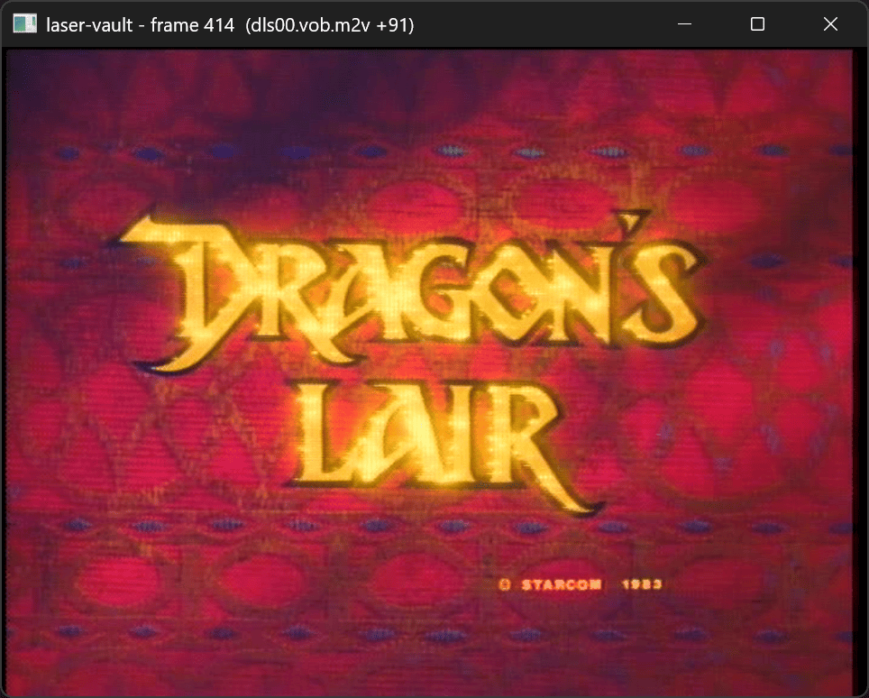
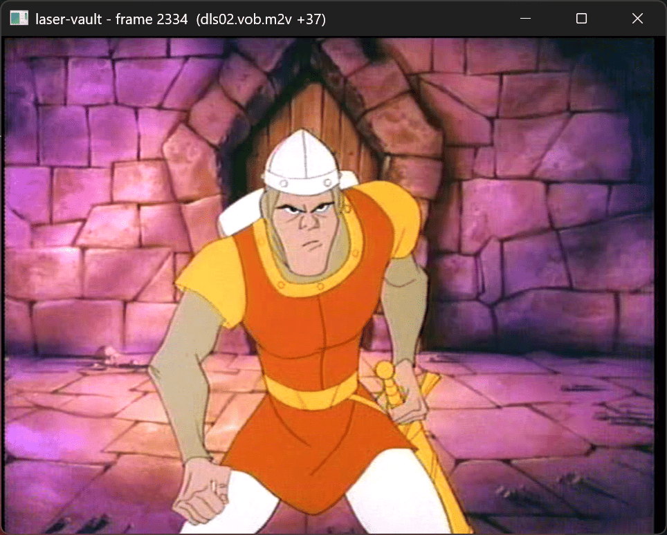
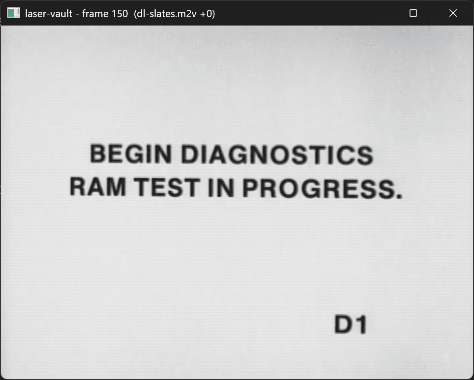
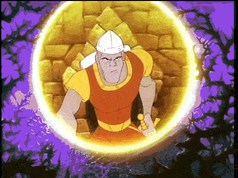

# LaserVault

A small, readable laserdisc arcade game emulator, written from scratch in C11
with SDL3 and FFmpeg. First target: *Dragon's Lair*.

**Stage 4 (current):** Dragon's Lair runs. The original game code runs on an
emulated Z80 and drives an emulated Pioneer LD-V1000 laserdisc player: the
attract mode plays, and you can insert coins and start a game, with the
laserdisc's soundtrack and the game board's own beeps.

Earlier stages: showing any frame by number (1), a laserdisc player you drive
from the keyboard (2), and the Z80 running the ROM (3).

<p align="center">
  <a href="assets/laser-vault-dl-title.png"></a>
  <a href="assets/laser-vault-dl-dirk.png"></a>
  <a href="assets/laser-vault-ram-test.png"></a>
</p>

<p align="center">
  <a href="assets/dl-530-715.gif"></a>
</p>

## Setting up a development environment

You need a C compiler, CMake (3.21 or newer), [SDL3](https://www.libsdl.org/)
(3.2 or newer), FFmpeg's development libraries (libavcodec, libavformat,
libavutil) and zlib. How you get them depends on the platform. Each section below goes
from a fresh machine to a built `laser-vault`.

### Windows (native, with Visual Studio)

On Windows, the libraries come from [vcpkg](https://github.com/microsoft/vcpkg),
a package manager that builds them from source. The project's `vcpkg.json`
lists what it needs, and CMake asks vcpkg for them automatically.

1. Install [Git for Windows](https://git-scm.com/download/win).
2. Install [Visual Studio 2022](https://visualstudio.microsoft.com/downloads/)
   (the free Community edition or the *Build Tools for Visual Studio 2022*) with
   the **Desktop development with C++** workload. It includes the MSVC compiler,
   CMake and Ninja, so you don't need to install those separately.

   **Or, from the command line with winget**, instead of steps 1 and 2:
   ```
   winget install -e --id Git.Git --source winget
   winget install -e --id Microsoft.VisualStudio.2022.BuildTools --source winget --override "--passive --wait --add Microsoft.VisualStudio.Workload.VCTools --add Microsoft.VisualStudio.Component.VC.CMake.Project --includeRecommended"
   ```
   The `--override` part matters: without it, winget installs Build Tools
   with no C++ compiler. `VCTools` is the C++ workload, and the
   `VC.CMake.Project` component brings CMake and Ninja. Then open a new
   terminal so `git` is on your PATH. (Visual Studio 2026 Build Tools,
   `Microsoft.VisualStudio.BuildTools`, will probably work too but hasn't been
   tested; its Start menu entry is "Developer PowerShell for VS 2026".)
3. Install vcpkg somewhere outside this project, for example `C:\vcpkg`:
   ```
   git clone https://github.com/microsoft/vcpkg C:\vcpkg
   C:\vcpkg\bootstrap-vcpkg.bat -disableMetrics
   ```
4. Open **Developer PowerShell for VS 2022** from the Start menu. (It sets up
   the compiler; a plain PowerShell window won't find it.) Then:
   ```
   $env:VCPKG_ROOT = "C:\vcpkg"
   cd path\to\laser-vault
   cmake --preset windows
   cmake --build --preset windows
   ```
   To avoid setting `VCPKG_ROOT` every time, set it once as a user
   environment variable, either in Windows settings or with
   `setx VCPKG_ROOT C:\vcpkg` (this applies to terminals opened afterwards).

The first `cmake --preset windows` builds SDL3 and FFmpeg, which takes a
while (around 15 to 30 minutes). vcpkg caches the results, so later builds,
and other checkouts on the same machine, are fast.

The program ends up at `build\windows\laser-vault.exe`, with the DLLs it
needs copied next to it.

### Windows (WSL)

You can also build the Linux version inside WSL (Windows Subsystem for Linux).
On Windows 11, Linux GUI programs open as normal windows.

1. In PowerShell: `wsl --install -d Ubuntu-24.04`, then restart if asked and
   create your Linux user.
2. Open the Ubuntu terminal and follow the **Linux (Ubuntu / Debian)** steps
   below. Your Windows drives are under `/mnt`, so `F:\code\laser-vault` is
   `/mnt/f/code/laser-vault`.

Building on `/mnt/...` works but is slower than inside the Linux file system,
and `make` may print harmless "clock skew" warnings.

### Linux (Ubuntu / Debian)

1. Install the compiler, build tools and FFmpeg:
   ```
   sudo apt install build-essential git cmake ninja-build pkg-config \
       libavcodec-dev libavformat-dev libavutil-dev zlib1g-dev
   ```
2. Install SDL3. **Ubuntu 25.04 or newer:** `sudo apt install libsdl3-dev`,
   and you're done with this step. **Ubuntu 24.04** has no SDL3 package, so
   build it from source. First install the libraries SDL3 uses to talk to
   the display, sound and input devices:
   ```
   sudo apt install libx11-dev libxext-dev libxrandr-dev libxcursor-dev \
       libxi-dev libxss-dev libxfixes-dev libxtst-dev libxkbcommon-dev \
       libwayland-dev wayland-protocols libegl-dev libgl-dev libdrm-dev \
       libgbm-dev libpulse-dev libasound2-dev libpipewire-0.3-dev \
       libdecor-0-dev libudev-dev libdbus-1-dev
   ```
   Then build SDL3 and install it into `~/.local` (no `sudo` needed):
   ```
   git clone --depth 1 --branch release-3.4.18 https://github.com/libsdl-org/SDL.git ~/src/SDL
   cmake -S ~/src/SDL -B ~/src/SDL/build -G Ninja -DCMAKE_BUILD_TYPE=Release \
       -DCMAKE_INSTALL_PREFIX=$HOME/.local -DSDL_TESTS=OFF -DSDL_EXAMPLES=OFF
   cmake --build ~/src/SDL/build
   cmake --install ~/src/SDL/build
   ```
3. Build laser-vault. Leave out `-DCMAKE_PREFIX_PATH=...` if SDL3 came from apt:
   ```
   cd path/to/laser-vault
   cmake --preset linux -DCMAKE_PREFIX_PATH=$HOME/.local
   cmake --build --preset linux
   ```

The program ends up at `build/linux/laser-vault`. On other distributions,
install the same things with your package manager: a C compiler, CMake,
pkg-config, FFmpeg and zlib development packages, and SDL3 if your distribution
packages it (otherwise build it from source as above).

### macOS

Using [Homebrew](https://brew.sh/):

1. Install Apple's command-line developer tools: `xcode-select --install`.
2. Install the tools and libraries: `brew install cmake pkg-config ffmpeg sdl3`.
3. Build:
   ```
   cd path/to/laser-vault
   cmake --preset macos -DCMAKE_PREFIX_PATH=$(brew --prefix)
   cmake --build --preset macos
   ```

The program ends up at `build/macos/laser-vault`.

## Running

You need your own copy of the game's video: Daphne-style `.m2v` clips plus a
framefile that maps disc frame numbers to clips. If the video came as an
archive, extract it with [7-Zip](https://www.7-zip.org/) or `unrar`. For
split archives, point the tool at the first part. There's no need to run a
self-extracting `.exe`.

To play Dragon's Lair you also need the rev F2 ROMs: `lair.zip`, or a folder
holding `dl_f2_u1.bin` to `dl_f2_u4.bin`.

```
laser-vault path/to/dragonslair.txt --video-dir path/to/mpeg/dragonslair --roms path/to/lair.zip
```

If `--video-dir` is omitted, clips are looked up next to the framefile.
`--disc-fps` sets the rate the disc frame numbers count at (default 23.976,
right for Dragon's Lair; see `src/video/disc_video.h`). Each game shows its
own window icon, built into the program from `icons/`; `--icon
FILE.ico` uses a different one.

Like the real machine, the game waits about 20 seconds for the laserdisc to
spin up, and the attract mode starts after about 35 seconds. Add
`--fast-boot` to skip that wait: the start-up runs at full speed before the
window appears, and you land straight in the attract mode. The default
settings take two coins per credit, so press 5 twice, then 1.

| Key                   | Action                                    |
|-----------------------|-------------------------------------------|
| Arrow keys            | joystick                                  |
| Space / Ctrl          | sword                                     |
| 5 / 6                 | insert a coin (slot 1 / 2)                |
| 1 / 2                 | start (1 / 2 players)                     |
| S                     | show / hide the score displays            |
| D                     | turn combing repair off / on              |
| Escape                | quit                                      |

On the arcade cabinet the scores, lives and credits aren't on the screen:
they're on LED displays in the bezel around it. Add `--scores` (or press S)
to show them in a panel beside the picture. The window title also shows the
raw display digits and what the laserdisc player is doing.

Between scenes the screen goes black for a moment while the laserdisc player
searches, as on the real machine; longer jumps take a little longer (from
about 0.1 s up to 0.3 s).

The soundtrack comes from the `.ogg` file next to each video clip, played in
step with the picture. With the factory settings the attract mode is mostly
silent: a DIP switch ("Sound Every 8 Attracts") has the game turn the disc's
sound off and only let it through every few attract cycles, about every five
minutes. Add `--attract-sound` to flip that switch and hear every cycle.

The beeps (for coins, and short "feedback" tones when you move the joystick
or press the sword button) come from the board's AY-3-8910 sound chip, which
is emulated too and mixed in with the soundtrack.

### Driving the laserdisc player yourself

Leave out `--roms` and you take the game's place: the keyboard controls the
laserdisc player directly. Add `--frame N` to start somewhere other than the
first frame.

| Key                   | Action                                    |
|-----------------------|-------------------------------------------|
| Space                 | play / pause                              |
| S                     | stop                                      |
| Left / Right          | step one frame back / forward (pauses)    |
| Down / Up             | search one second back / forward          |
| Page Down / Page Up   | search ten seconds back / forward         |
| Home / End            | search to the first / last clip           |
| D                     | turn combing repair off / on              |
| digits, then Enter    | search to that frame number               |
| Escape                | cancel typing, or quit                    |

The player starts paused on the first frame (or `--frame`). Like the
Pioneer LD-V1000 in the Dragon's Lair cabinet, a search ends paused on the
target frame; press Space to play from there.

## Tools

`disc-gif` turns a range of disc frames into an animated GIF, using the same
video code as the emulator. It's built alongside `laser-vault`.

```
disc-gif path/to/dragonslair.txt --video-dir path/to/mpeg/dragonslair --from 530 --to 715 -o intro.gif
```

| Option        | Default | Meaning                                                    |
|---------------|---------|------------------------------------------------------------|
| `--width W`   | 480     | output width; the height follows from 4:3                  |
| `--fps F`     | 12      | frames per second in the GIF                               |
| `--noise N`   | 24      | ignore colour changes smaller than this (smaller files)    |
| `--disc-fps F`| 23.976  | rate the disc frame numbers count at                       |

The GIF encoder (`src/tools/gif.c`) is written from scratch and commented,
if you're curious how GIF palettes and LZW compression work.

`dlair-trace` runs Dragon's Lair without a window or video, hundreds of
times faster than real time, and prints what happens: every command the game
sends to the laserdisc player, every change in what the player is doing, and
every change to the score display. `--press` scripts the controls.

```
dlair-trace path/to/lair.zip --seconds 60 --press coin1@40 --press coin1@41 --press start1@43
```

After about 35 seconds of game time you'll see it search to frame 323, where
the attract mode's video starts. With the presses above, a game starts at
frame 1424. Buttons: `up down left right sword start1 start2 coin1 coin2`.
`--dsw1 HEX` and `--dsw2 HEX` set the DIP switches (defaults `20` and `79`).

## Testing the Z80

The Z80 CPU emulator (`src/cpu/z80.c`) is checked with Frank D. Cringle's
ZEXDOC and ZEXALL instruction exercisers. They run every Z80 instruction over
a huge range of inputs and compare the results against a real Z80; ZEXALL
also checks the undocumented flag bits. They're GPL-licensed CP/M programs,
so they aren't included here. Get `zexdoc.com` and `zexall.com` from
[agn453/ZEXALL](https://github.com/agn453/ZEXALL), then run:

```
z80-zex path/to/zexall.com
```

All 67 tests should print `OK`. A full run is about 47 billion clock cycles
and takes a minute or two.

## Source map

- `src/main.c`: window, keyboard, main loop, drawing.
- `src/ldp/ldp.c`: the laserdisc player model (play, pause, search, step).
- `src/ldp/ldv1000.c`: the Pioneer LD-V1000's command protocol, on top of that model.
- `src/cpu/z80.c`: the Z80 CPU emulator.
- `src/games/dlair/dlair.c`: the Dragon's Lair board (memory map, inputs, outputs, interrupts).
- `src/util/zip.c`: reading ROMs out of zip files.
- `src/video/framefile.c`: framefile parsing (disc frame → clip + offset).
- `src/video/disc_video.c`: MPEG-2 decoding and seeking with FFmpeg.
- `src/video/decomb.c`: detecting and repairing combed (mixed-field) frames.
- `src/audio/disc_audio.c`: the laserdisc's soundtrack, kept in step with the picture.
- `src/audio/ay8910.c`: the AY-3-8910 sound chip on the game board.
- `src/ui/bezel.c`: the score displays, drawn as seven-segment LED digits.
- `src/ui/icon.c`: reading Windows `.ico` files for the window icon.
- `src/tools/disc_gif.c`: the `disc-gif` tool (decode, scale, sample).
- `src/tools/gif.c`: GIF writer (median-cut palette, LZW compression).
- `src/tools/dlair_trace.c`: the `dlair-trace` tool.
- `tests/z80_zex.c`: runs ZEXDOC/ZEXALL on the Z80 (a tiny stand-in for CP/M).
- `icons/`: each game's window icon. CMake builds them into the program
  (`cmake/embed_file.cmake` turns a file into a C array); to add one, put
  `name.ico` there and add `name` to `EMBEDDED_ICONS` in `CMakeLists.txt`.

## License

**LaserVault**, A Laser Disc Player\
Copyright (C) 2026 [Jeff Nyman][owner]

[][GNU General Public License]

> This program is free software: you can redistribute it and/or modify
> it under the terms of the [GNU General Public License] as published by
> the Free Software Foundation, either version 3 of the License, or
> (at your option) any later version.
>
> This program is distributed in the hope that it will be useful,
> but WITHOUT ANY WARRANTY; without even the implied warranty of
> MERCHANTABILITY or FITNESS FOR A PARTICULAR PURPOSE. See the
> [GNU General Public License] for more details.

[owner]: https://github.com/jeffnyman
[GNU General Public License]: https://www.gnu.org/licenses/gpl-3.0.en.html
